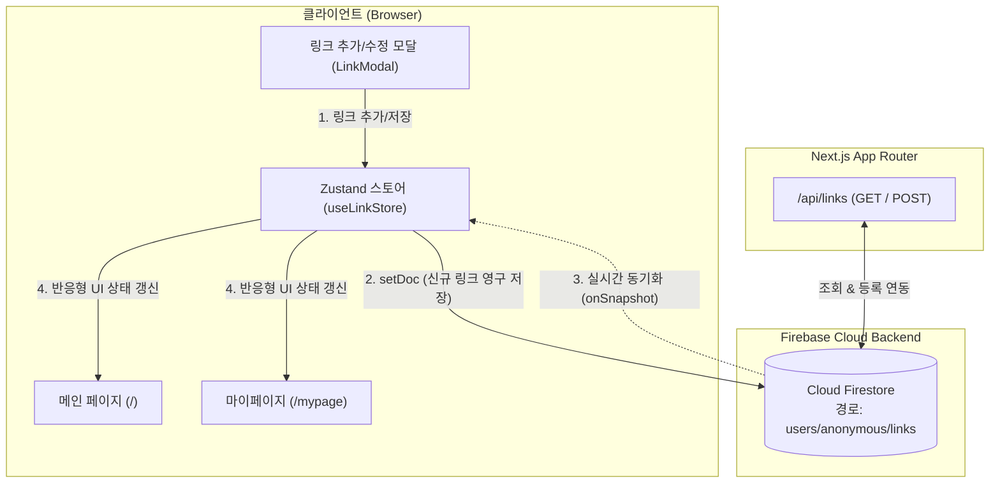

# 🔗 MyLink (마이링크) — Gyumin Lim's Hub

> **피지컬 AI & 로보틱스 엔지니어 임규민의 통합 프로필 & 포트폴리오 허브**  
> SOCAR Frame 2.0 디자인 시스템 및 모던 Next.js 16 / Firebase Firestore 기반 경량 링크트리 서비스

---

## 📌 현재 개발 진행 상황 (Development Progress)

| 구분 | 기능 / 작업 항목 | 진행 상태 | 세부 내용 |
| :--- | :--- | :---: | :--- |
| **디자인 & UI** | SOCAR Frame 2.0 디자인 시스템 적용 | ✅ 완료 | 정갈한 타이포그래피, 14px/16px 라운드 카드, 블루 포인트 테마 |
| **반응형 UI** | 모바일 스몰(320px) ~ 데스크톱 최적화 | ✅ 완료 | 한 손 조작 바텀 고정 액션바, 반응형 그리드 & 스켈레톤 UI |
| **프로필 & 마이페이지** | 개인화 프로필 허브 (`/mypage`) | ✅ 완료 | 프로필 사진, 한 줄 소개, GitHub & 이메일 클립보드 복사 액션 |
| **링크 관리 (CRUD)** | 링크 추가/수정/삭제 모달 | ✅ 완료 | 빈칸 방지 및 `https://` 자동 정규화 유효성 검사 내장 |
| **데이터베이스 연동** | **Firestore 마이그레이션 (`users/anonymous/links`)** | ✅ 완료 | **링크 추가 시 Firestore 즉시 저장, 실시간 동기화 (`onSnapshot`)** |
| **상태 관리** | Zustand 전역 스토어 & LocalStorage 동기화 | ✅ 완료 | 오프라인 폴백 지원 및 실시간 상태 동기화 |
| **백엔드 API** | Next.js App Router API (`GET/POST /api/links`) | ✅ 완료 | Firestore `users/anonymous/links` 우선 조회 및 REST 등록 지원 |
| **인증 시스템** | NextAuth v5 + Google OAuth 연동 | ⏳ 준비 중 | 멀티 테넌트 사용자 분리 (Phase 2 계획) |

---

## 🏗️ 시스템 아키텍처 및 데이터 흐름



---

## 🛠️ 기술 스택 (Tech Stack)

- **Framework**: [Next.js 16](https://nextjs.org) (App Router, Turbopack)
- **Frontend Core**: [React 19](https://react.dev), TypeScript 5
- **Styling**: Tailwind CSS v4, SOCAR Frame 2.0 Design Tokens, Radix UI Primitives, Lucide Icons
- **State Management**: [Zustand 5](https://zustand-demo.pmnd.rs/) with LocalStorage Persist & Firestore Realtime Sync
- **Backend & Database**: [Firebase v13](https://firebase.google.com/) (Cloud Firestore)
- **Authentication**: NextAuth.js v5 (Beta)

---

## 📂 프로젝트 디렉토리 구조

```text
src/
├── app/
│   ├── api/
│   │   ├── auth/[...nextauth]/route.ts  # NextAuth 인증 핸들러
│   │   └── links/route.ts               # Firestore 연동 링크 API (GET/POST)
│   ├── mypage/page.tsx                  # 개인화 마이페이지
│   ├── globals.css                      # Tailwind v4 & SOCAR 프레임 토큰
│   ├── layout.tsx                       # 공통 루트 레이아웃
│   └── page.tsx                         # 메인 링크트리 화면
├── components/
│   ├── CategoryFilter.tsx               # 카테고리 필터 칩
│   ├── DeleteConfirmDialog.tsx          # 삭제 확인 다이얼로그
│   ├── LinkCard.tsx                     # 개별 링크 카드 (조회수/공개토글)
│   ├── LinkModal.tsx                    # 신규 링크 등록/수정 모달
│   ├── ProfileSection.tsx               # 상단 프로필 및 소셜 액션
│   ├── TopAppBar.tsx                    # 상단 네비게이션 및 모드 전환
│   └── ui/                              # shadcn / Radix 기반 공통 UI
├── lib/
│   ├── firebase.ts                      # Firebase 초기화 싱글톤 인스턴스
│   ├── firestoreLinks.ts                # Firestore (users/anonymous/links) CRUD 서비스
│   ├── store.ts                         # Zustand 전역 스토어 & 동기화 로직
│   └── url.ts                           # URL 유효성 검증 및 정규화 유틸
└── types/
    └── link.ts                          # LinkItem, Profile, Category 타입 정의
```

---

## 🚀 로컬 실행 방법 (Getting Started)

### 1. 패키지 설치
```bash
npm install
```

### 2. 환경 변수 설정 (`.env.local`)
```env
# Firebase Configuration
NEXT_PUBLIC_FIREBASE_API_KEY="your_api_key"
NEXT_PUBLIC_FIREBASE_AUTH_DOMAIN="my-gm-link.firebaseapp.com"
NEXT_PUBLIC_FIREBASE_PROJECT_ID="my-gm-link"
NEXT_PUBLIC_FIREBASE_STORAGE_BUCKET="my-gm-link.firebasestorage.app"
NEXT_PUBLIC_FIREBASE_MESSAGING_SENDER_ID="your_sender_id"
NEXT_PUBLIC_FIREBASE_APP_ID="your_app_id"
NEXT_PUBLIC_FIREBASE_MEASUREMENT_ID="your_measurement_id"
```

### 3. 개발 서버 시작
```bash
npm run dev
```

브라우저에서 [http://localhost:3000](http://localhost:3000)으로 접속하여 바로 확인할 수 있습니다.

---

## 📝 커밋 히스토리 주요 이력
- `da01985`: feat: 링크 추가 시 Firestore(users/anonymous/links) 저장 연동 및 실시간 동기화 마이그레이션
- `6265a3b`: docs: PRD v1.4.0 업데이트 - 시연용 Phase 1 전략, 사용자 시나리오 및 메인 와이어프레임 반영
- `72a108a`: feat: SOCAR Frame 2.0 디자인 시스템 명세 저장 및 프로필 UI 전면 리뉴얼
- `c9ae522`: fix: 모바일 스몰(320px) 반응형 UI 레이아웃 및 버튼 깨짐 방지 최적화
