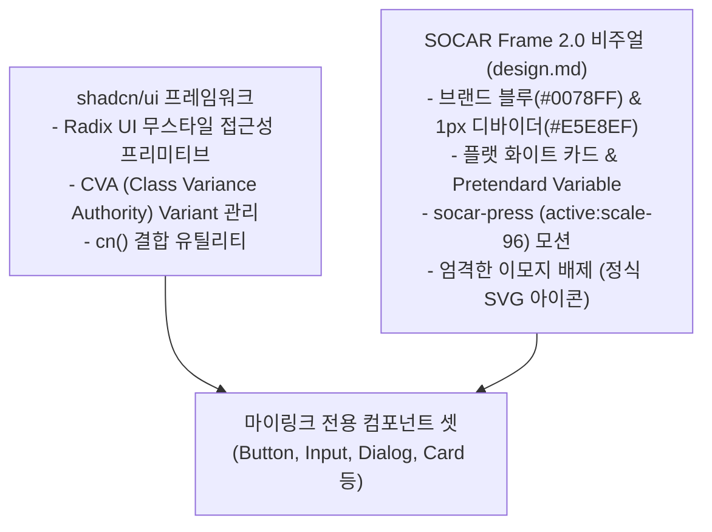
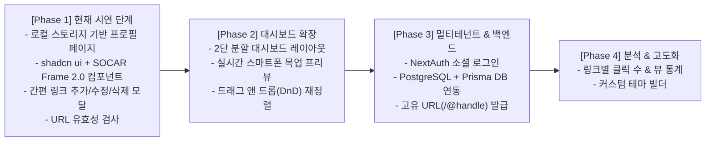

# [PRD] 링크트리 클론 서비스 — "마이링크 (MyLink)" 기능 정의서

- **버전**: v1.5.0 (shadcn/ui 기반 SOCAR Frame 2.0 디자인 시스템 통합 스펙)
- **작성일**: 2026-10-17
- **상태**: 승인 및 Phase 1 시연 준비
- **디자인 아키텍처**: **shadcn/ui (Radix UI + CVA) + SOCAR Frame 2.0 Visual Identity (design.md)**
- **상태 및 데이터 관리**: Zustand + `localStorage` 영속성 (Phase 1)

---

## 1. 프로젝트 개요 & 시연 전략 (Overview & Strategy)

### 1.1 배경 및 목적
"마이링크 (MyLink)"는 흩어져 있는 사용자의 링크와 프로필을 단 하나의 페이지에 깔끔하게 집약하는 링크트리 클론 서비스입니다.  
현재는 **서비스 빌딩 과정을 단계별로 시연(Demo)**하는 단계이므로, 복잡한 백엔드 인프라나 대시보드 대신 **"로컬 스토리지를 활용한 완성도 높은 프로필 페이지"**를 1단계 목표로 집중 개발합니다.

### 1.2 디자인 시스템 원칙 (shadcn/ui × SOCAR Frame 2.0)
앞으로의 모든 UI 컴포넌트와 화면 디자인은 **[shadcn/ui](https://ui.shadcn.com/) 아키텍처를 기반으로 구축하되, [docs/design.md](docs/design.md)의 SOCAR Frame 2.0 시각 언어를 입혀 일원화**합니다.



### 1.3 단계별 개발 전략 (Phased Approach)



---

## 2. 사용자 시나리오 (User Scenarios)

### 2.1 방문자 관점 시나리오 (다른 사람의 마이링크 페이지를 방문하는 과정)
> **핵심 가치**: 복잡한 탐색 없이 3초 안에 대상자의 핵심 링크와 프로필을 확인하고 원하는 채널로 안전하게 이동

1. **페이지 진입**
   - 사용자는 관심 있는 크리에이터나 개발자의 활동 링크를 한눈에 모아보기 위해 SNS 프로필이나 메시지에 공유된 마이링크 웹 링크를 터치/클릭한다.
2. **프로필 및 브랜딩 확인**
   - 사용자는 해당 인물이 누구인지 직관적으로 파악하기 위해 화면 상단의 프로필 아바타 이미지, 표시 이름, 한 줄 소개(Bio)를 확인한다.
3. **소셜 채널 탐색**
   - 사용자는 해당 인물의 다른 공식 소통 채널(GitHub, 이메일, Instagram 등)을 확인하기 위해 프로필 하단의 소셜 아이콘 바를 탐색한다.
4. **목적 링크 선택**
   - 사용자는 관심 있는 프로젝트, 최신 콘텐츠, 아티클 등으로 이동하기 위해 화면에 정갈하게 나열된 링크 카드 중 원하는 항목을 터치한다.
5. **안전한 외부 이동**
   - 사용자는 기존 마이링크 창을 닫지 않고 유지한 채 목적지 페이지를 둘러보기 위해 새 탭으로 열린 외부 웹사이트로 안전하게 이동한다.

---

### 2.2 소유자 관점 시나리오 (자신의 마이링크를 관리하는 과정: 링크 추가, 수정, 삭제)
> **핵심 가치**: 별도의 복잡한 관리자 설정 없이, 프로필 화면에서 직접 링크를 즉시 추가·수정·삭제하고 브라우저에 안전하게 보존

#### [시나리오 A: 신규 링크 추가]
1. **추가 모달 호출**
   - 사용자는 방문자들에게 새롭게 공유하고 싶은 프로젝트나 채널을 등록하기 위해 화면에 제공된 `+ 새 링크 추가` 버튼을 터치한다.
2. **정보 입력 및 URL 유효성 검증**
   - 사용자는 링크의 직관적인 제목(Title)과 이동할 웹 주소(URL)를 입력하기 위해 입력 필드에 텍스트를 작성하며, 잘못된 주소 등록을 방지하기 위해 실시간 URL 유효성 검사(HTTP/HTTPS 자동 보정 안내)를 확인한다.
3. **등록 완료 및 즉시 확인**
   - 사용자는 새 링크를 목록에 즉각 반영하기 위해 `추가하기` 버튼을 누르고, 페이지 새로고침 없이 즉시 목록 최상단에 새 링크 카드가 렌더링되는 것을 확인한다.

#### [시나리오 B: 기존 링크 수정]
1. **수정 모달 호출**
   - 사용자는 기존 링크의 오타를 고치거나 변경된 URL로 갱신하기 위해 해당 링크 카드 우측의 `수정(옵션)` 버튼을 터치한다.
2. **내용 갱신 및 유효성 재검증**
   - 사용자는 수정할 링크 제목과 새 웹 주소를 반영하기 위해 입력값을 편집하고 유효한 URL 포맷인지 확인한다.
3. **수정 내용 반영**
   - 사용자는 수정된 내용을 확정하기 위해 `수정 완료` 버튼을 누르고, 해당 카드의 텍스트와 연결 링크가 즉각 갱신되는 것을 확인한다.

#### [시나리오 C: 링크 노출 토글 및 삭제]
1. **임시 노출 숨김 (토글)**
   - 사용자는 링크를 완전히 지우지 않고 일시적으로 방문자에게 감추기 위해 해당 링크의 `노출 활성화(ON/OFF)` 스위치를 끈다.
2. **완전 삭제**
   - 사용자는 더 이상 운영하지 않는 링크를 목록에서 완전히 제거하기 위해 `삭제` 버튼을 터치하고, 삭제 확인 다이얼로그(Alert)를 승인하여 목록에서 영구 제거한다.

#### [시나리오 D: 로컬 스토리지 데이터 영속성 (Persistence)]
1. **데이터 저장 검증**
   - 사용자는 내가 방금 추가·수정한 링크들이 온전히 저장되었는지 확인하기 위해 브라우저 페이지를 새로고침(F5)하거나 탭을 닫았다가 다시 접속한다.
2. **자동 복원 확인**
   - 사용자는 백엔드 서버가 없어도 `localStorage`에 안전하게 보존된 프로필 정보와 링크 목록이 브라우저에 그대로 복원되어 있음을 확인한다.

---

## 3. 메인 화면 (방문자 뷰) 와이어프레임 & UI 스펙

### 3.1 화면 레이아웃 와이어프레임 (모바일 375px 기준)

```text
┌──────────────────────────────────────────────────┐
│ [TopAppBar]                                      │
│  MyLink                           [공유하기 ↗]   │ <- 52px 고정 상단바 (1px 하단 보더)
├──────────────────────────────────────────────────┤
│                                                  │
│   ┌──────────────────────────────────────────┐   │
│   │ [Profile Section]                        │   │ <- 16px 라운드 화이트 카드
│   │                                          │   │
│   │                 ┌──────┐                 │   │
│   │                 │ [사진]│                 │   │ <- 80x80px 아바타 (rounded-2xl)
│   │                 └──────┘                 │   │
│   │                 임 규 민                 │   │ <- Heading (Bold 700 / 20px)
│   │      Robotics & Full-Stack AI Engineer   │   │ <- Title (Semibold 600 / 14px)
│   │                                          │   │
│   │   "현실의 하드웨어와 모던 웹을 연결합니다"   │   │ <- Body (Regular 400 / 13px)
│   │                                          │   │
│   │     ────────────────────────────────     │   │ <- 1px 헤어라인 디바이더 (#E5E8EF)
│   │                                          │   │
│   │    [ 깃허브 ]  [ 이메일 ]  [ 인스타 ]    │   │ <- 소셜 아이콘 바 (원형 SVG 버튼)
│   │                                          │   │
│   └──────────────────────────────────────────┘   │
│                                                  │
│   ┌──────────────────────────────────────────┐   │
│   │ [Link Card 01]                           │   │ <- 14px 라운드 플랫 카드
│   │  Lerobot S-101 배터리 전압 분류 로봇  [↗]│   │    (높이 56px, 호버/탭 시 scale 96%)
│   └──────────────────────────────────────────┘   │
│                                                  │
│   ┌──────────────────────────────────────────┐   │
│   │ [Link Card 02]                           │   │
│   │  MyLink 프로젝트 GitHub 저장소        [↗]│   │
│   └──────────────────────────────────────────┘   │
│                                                  │
│   ┌──────────────────────────────────────────┐   │
│   │ [Link Card 03]                           │   │
│   │  기술 블로그 & 연구 노트 바로가기     [↗]│   │
│   └──────────────────────────────────────────┘   │
│                                                  │
│   ┌──────────────────────────────────────────┐   │
│   │ [Link Card 04]                           │   │
│   │  커리어 이력서 & 포트폴리오 PDF       [↗]│   │
│   └──────────────────────────────────────────┘   │
│                                                  │
│                   - - - - -                      │
│                                                  │
│         [ + 나도 마이링크 만들기 (CTA) ]         │ <- 하단 액션 버튼 (ActionButton Primary)
│                                                  │
│           © 2026 MyLink. Powered by SOCAR Frame  │ <- 푸터 (Caption 11px)
│                                                  │
└──────────────────────────────────────────────────┘
```

---

## 4. shadcn/ui 기반 SOCAR 디자인 시스템 컴포넌트 명세

모든 컴포넌트는 `components.json`의 alias(`@/components/ui/*`)에 위치하며, shadcn의 CVA를 통해 SOCAR Frame 2.0 시각 스펙을 구현합니다.

| 컴포넌트 | shadcn 프리미티브 | SOCAR Frame 2.0 스타일 명세 |
|---|---|---|
| **Button** | `@radix-ui/react-slot` + CVA | • `default`: SOCAR 블루(`#0078FF`), 탭 시 `scale(0.96)`<br>• `secondary`: 연한 파랑(`#EBF5FF`) + 블루 텍스트<br>• `outline`: 흰 배경 + 1px 보더(`#E5E8EF`) |
| **Input** | HTML `<input>` + CVA | • `h-10`, `rounded-[10px]`, 배경 `#FFFFFF`, 1px 보더(`#E5E8EF`)<br>• Focus 시 2px 블루(`#0078FF`) 링 강조 |
| **Dialog** | `@radix-ui/react-dialog` | • 모달 오버레이: `bg-black/40 backdrop-blur-xs`<br>• 패널: `rounded-2xl`, 흰색 배경, 1px 보더, 그림자 절제 |
| **Card** | `div` 기반 슬롯 구조 | • `rounded-2xl`, 배경 `#FFFFFF`, 1px 디바이더(`#E5E8EF`), 플랫 표면 |
| **Icons** | `lucide-react` (커스텀 래퍼) | • 엄격한 이모지 배제 규칙 준수, 정갈한 2px 라인 SVG 아이콘 사용 |

---

## 5. Phase 1 (시연용 프로필 페이지) 핵심 요구사항 명세

### 5.1 프로필 페이지 뷰 (Profile View)
| ID | 기능명 | 상세 설명 | 우선순위 |
|---|---|---|---|
| **P1-VIEW-01** | SOCAR Frame 2.0 디자인 | 단일 브랜드 블루(`#0078FF`), 1px 디바이더(`#E5E8EF`), 플랫 화이트 카드, Pretendard 서체 및 이모지 배제 준수 | P0 (Must) |
| **P1-VIEW-02** | 프로필 헤더 | 프로필 아바타 이미지, 표시 이름(Display Name), 한 줄 소개(Bio) 노출 | P0 (Must) |
| **P1-VIEW-03** | 링크 목록 렌더링 | 등록된 활성 링크들을 카드 형태로 정갈하게 나열 (클릭 시 새 탭으로 타깃 URL 안전 이동) | P0 (Must) |
| **P1-VIEW-04** | 소셜 아이콘 바 | GitHub, 이메일, Instagram 등 등록된 소셜 프로필 아이콘 링크 바 노출 | P0 (Must) |
| **P1-VIEW-05** | 반응형 모바일 최적화 | 320px 모바일 스몰부터 데스크톱까지 완벽한 1단 카드 레이아웃 유지 | P0 (Must) |

### 5.2 간편 링크 관리 & 로컬 스토리지 (Link Management & Persistence)
| ID | 기능명 | 상세 설명 | 우선순위 |
|---|---|---|---|
| **P1-MNG-01** | `localStorage` 영속성 | 브라우저를 새로고침하거나 껐다 켜도 사용자가 추가/수정한 링크와 프로필 정보가 로컬 스토리지에 자동 저장·유지됨 | P0 (Must) |
| **P1-MNG-02** | 간편 링크 추가 모달 (Dialog) | shadcn/ui Dialog 기반으로 페이지 내에서 간편하게 새 링크 등록 | P0 (Must) |
| **P1-MNG-03** | URL 유효성 검사 | 링크 등록 시 `http://` 또는 `https://` 누락 자동 보정 및 올바른 웹 URL 형식 실시간 검증(잘못된 URL 입력 시 친절한 에러 안내) | P0 (Must) |
| **P1-MNG-04** | 링크 수정 및 삭제 | 각 링크 카드 우측 옵션 메뉴를 통해 제목/URL 인라인 수정 및 삭제 가능 | P0 (Must) |
| **P1-MNG-05** | 링크 ON/OFF 토글 | 삭제하지 않고도 특정 링크의 노출 여부를 스위치로 즉시 전환 | P0 (Must) |
| **P1-MNG-06** | 기본 데모 데이터 제공 | 최초 방문 시 빈 화면이 아닌 시연용 기본 데이터([src/data/mock-links.json](src/data/mock-links.json) 및 `GET /api/links` Mock API)가 로드되어 즉시 시연 가능 | P0 (Must) |

---

## 6. 데이터 구조 설계 & 더미 데이터 규격 (Data Schema & Mock Data)

### 6.1 시연용 더미 데이터셋 (`src/data/mock-links.json`)
서비스 최초 진입 및 데모 시연을 위해 `src/data/mock-links.json`에 정의된 8종의 표준 더미 링크 데이터와 프로필 데이터를 사용합니다.

- **더미 데이터 파일 경로**: `src/data/mock-links.json`
- **Mock API 엔드포인트**: `GET /api/links` (카테고리 필터링 `?category=`, 활성 필터링 `?activeOnly=true` 지원)
- **타입 정의 파일**: `src/types/link.ts`

#### 포함된 더미 데이터 목록
1. `link_01` (ROBOTICS): Lerobot S-101 배터리 전압 분류 로봇 시스템 (Featured, Active)
2. `link_02` (DEVELOPMENT): MyLink 엔지니어 프로필 & 포트폴리오 허브 (Featured, Active)
3. `link_03` (ROBOTICS): 실시간 로봇 관절 6축 텔레메트리 웹 대시보드 (Active)
4. `link_04` (ARTICLE): 기술 블로그 — 로보틱스 & 하드웨어 I/O 연구 노트 (Active)
5. `link_05` (PORTFOLIO): 2026 엔지니어링 이력서 & 포트폴리오 (PDF) (Active)
6. `link_06` (ROBOTICS): Hugging Face — 배터리 분류 로봇 오픈 데이터셋 (Active)
7. `link_07` (COMMUNITY): 로봇 러닝 & ROS2 한국 개발자 디스코드 (Active)
8. `link_08` (PORTFOLIO): [아카이브] 2024-2025 초기 프로젝트 노션 페이지 (Inactive 테스트용)

### 6.2 데이터 스키마 및 Mock API Envelope 인터페이스

```typescript
// src/types/link.ts 기반 스키마 규격
export interface LinkItem {
  id: string;
  title: string;
  description?: string;
  url: string;
  category: "ROBOTICS" | "DEVELOPMENT" | "PORTFOLIO" | "ARTICLE" | "COMMUNITY";
  icon?: string;
  isActive: boolean;
  isFeatured?: boolean;
  order: number;
  clickCount: number;
  createdAt: string;
  updatedAt: string;
}

export interface ApiResponse<T> {
  status: "success" | "error";
  statusCode: number;
  message: string;
  data: T;
  timestamp: string;
}
```

### 6.3 LocalStorage 저장 스키마
클라이언트 단에서는 `localStorage`의 `mylink_profile_data_v1` 키에 위 규격의 프로필 및 링크 상태를 영속화하여 관리합니다.


---

## 7. Phase 1 제외 항목 (시연 범위 외)

다음 항목들은 시연의 간결성과 속도를 위해 **Phase 1에서 명시적으로 제외**하며, 차후 단계에서 순차 도입합니다:
1. **대시보드 (2단 분할 레이아웃 & 실시간 모바일 목업)**: 프로필 페이지 내 인라인/모달 편집으로 대체
2. **통계 및 애널리틱스 (조회수/클릭수 카운터)**: 제외
3. **사용자 회원가입 & 로그인 (NextAuth)**: 제외 (로컬 스토리지로 100% 동작)
4. **원격 데이터베이스 (PostgreSQL / Prisma)**: 제외 (클라이언트 로컬 저장)
5. **서버 사이드 동적 라우팅(`/@username`)**: 제외 (현재는 단일 프로필 페이지에서 시연)

---

## 8. Phase 1 기술 스택

- **프레임워크**: Next.js 16 (App Router), React 19, TypeScript
- **UI 라이브러리**: **shadcn/ui** (Radix UI 프리미티브 + CVA)
- **디자인 시스템**: **SOCAR Frame 2.0 (design.md 기반 스타일링 & 토큰 결합)**
- **상태 관리**: **Zustand** (`persist` 미들웨어로 `localStorage`와 자동 동기화)
- **스타일링**: Tailwind CSS v4, SOCAR Frame 2.0 시각 토큰
- **아이콘**: Lucide React + 커스텀 SVG 라인 아이콘 (이모지 배제)
- **폰트**: Pretendard Variable
